<!-- Profile README for github.com/vamshisaideep9
     Every visual in /assets is generated by scripts/build_assets.py from profile.config.json + stats.json.
     stats.json (incl. private & org work) is refreshed daily by .github/workflows/profile.yml.
     Replace every YOUR-… link below with your real URL. -->


  &nbsp;
  <a href="mailto:vamshisaideepdesa@gmail.com">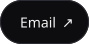</a>&nbsp;
  &nbsp;
  <a href="https://YOUR-PORTFOLIO">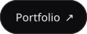</a>&nbsp;
  <a href="https://YOUR-RESUME-LINK">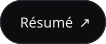</a>

 


  


  


<table>
<tr>
<td width="50%"><a href="https://github.com/arc53/DocsGPT/pull/1958"></a></td>
<td width="50%"><a href="https://github.com/brollysolutions/client1"></a></td>
</tr>
<tr>
<td width="50%"><a href="https://github.com/vamshisaideep9/Machine-Learning-Projects"></a></td>
<td width="50%"><a href="https://github.com/vamshisaideep9/Datascience-projects"></a></td>
</tr>
</table>

 


  


  

<a href="mailto:vamshisaideepdesa@gmail.com"></a>
