<!-- ═══════════════════════════════════════════════════════════════════════
     Profile README for github.com/vamshisaideep9
     Terminal-themed visuals in /assets are generated from profile.config.json + stats.json by
     scripts/build_assets.py (auto-runs via .github/workflows/build-assets.yml).
     Replace every YOUR-… placeholder link below with your real URL.
════════════════════════════════════════════════════════════════════════ -->

  

  
  
  
  
  



<table>
<tr>
<td width="50%" valign="top">
<h3><code>$ cat recruiters.txt</code></h3>
<ul>
<li><b>AI &amp; Full-Stack Engineer</b> — advanced RAG, LLM agents, web and Android</li>
<li>Stack: <b>FastAPI · PostgreSQL · Redis · Next.js · Kotlin · React Native</b></li>
<li>Open-source contributor to <a href="https://github.com/arc53/DocsGPT/pull/1958"><b>DocsGPT</b></a>; ships real client products</li>
<li>Open to <b>full-time AI / Full-Stack roles</b> · remote or hybrid</li>
</ul>
</td>
<td width="50%" valign="top">
<h3><code>$ cat clients.txt</code></h3>
<ul>
<li>One engineer for <b>AI + web + Android + SEO</b> — no hand-offs</li>
<li>Working prototypes in days with Claude Code &amp; Codex, reviewed by hand</li>
<li>Sites that <b>rank on Google</b>, not just look good</li>
<li>Clear scope, weekly demos — <a href="https://cal.com/+919059261395"><b>book a 20-min call</b></a></li>
</ul>
</td>
</tr>
</table>


<table>
<tr>
<td width="50%"></td>
<td width="50%"></td>
</tr>
<tr>
<td width="50%"></td>
<td width="50%"></td>
</tr>
</table>

<!-- 🎬 DEMO GIFs — record 10–15s clips (ScreenToGif / Kap / CleanShot), save to assets/demos/, then uncomment:

<b>▶ Watch the demos</b>

 

  
  

-->



  

  

<b>📈 Weekly contribution trend</b> — click to expand

 

<!-- Generated daily by .github/workflows/profile-3d.yml -->

  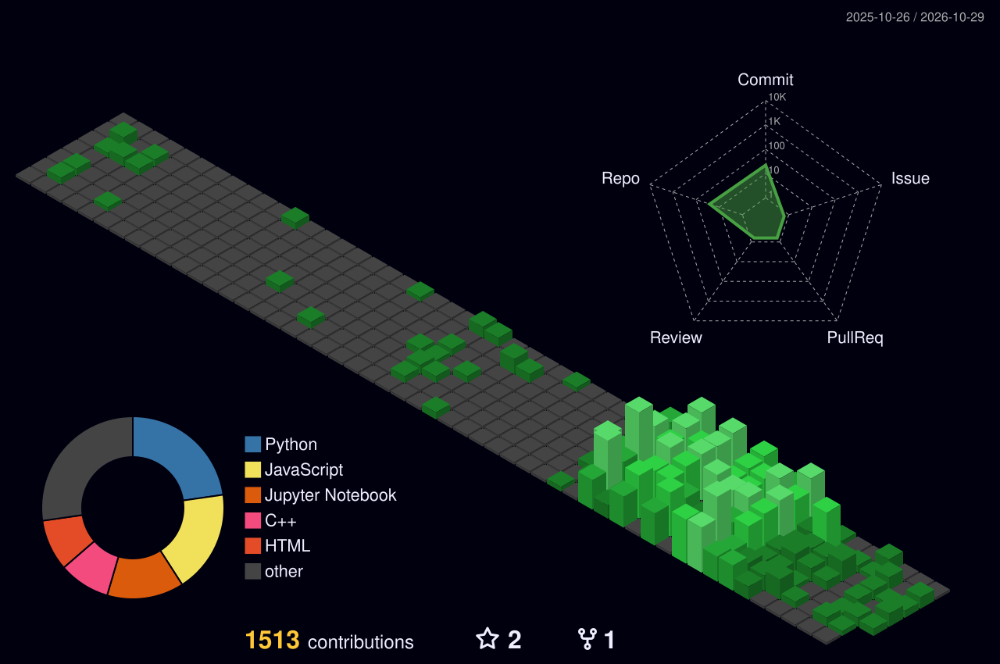

<!-- Generated daily by .github/workflows/snake.yml -->
<picture>
  <source media="(prefers-color-scheme: dark)" srcset="https://raw.githubusercontent.com/vamshisaideep9/vamshisaideep9/output/snake-dark.svg"/>
  <source media="(prefers-color-scheme: light)" srcset="https://raw.githubusercontent.com/vamshisaideep9/vamshisaideep9/output/snake-dark.svg"/>
  
</picture>


<table>
<tr>
<td width="50%" valign="top">

**✍️ Latest posts**
<!-- BLOG-POST-LIST:START -->
- Posts appear here automatically once you set the `BLOG_FEEDS` repo variable.
<!-- BLOG-POST-LIST:END -->

</td>
<td width="50%" valign="top">

**⚡ Recent GitHub activity**
<!--START_SECTION:activity-->
<!--END_SECTION:activity-->

</td>
</tr>
</table>


  <b>Passing by? Leave your mark.</b> Click below, then press <i>Submit</i> — a GitHub Action adds your avatar to this wall within a minute.

  

<!-- GUESTBOOK:START -->

No signatures yet. Be the first!

<!-- GUESTBOOK:END -->


<a href="mailto:vamshisaideepdesa@gmail.com"></a>

  

⚙️ How this profile works

 

- Every card is an SVG generated by [`scripts/build_assets.py`](scripts/build_assets.py) from [`profile.config.json`](profile.config.json), styled as a CRT terminal (JetBrains Mono, scanlines, Matrix rain).
- Stats include private and organisation work: [`scripts/fetch_stats.py`](scripts/fetch_stats.py) runs daily with a personal token and publishes **only totals** — no repo names, no code.
- The guestbook is issue-driven: opening a `guestbook|hi` issue triggers [a workflow](.github/workflows/guestbook.yml) that adds your avatar.
- The snake, 3D graph and activity feed are refreshed by scheduled GitHub Actions.

